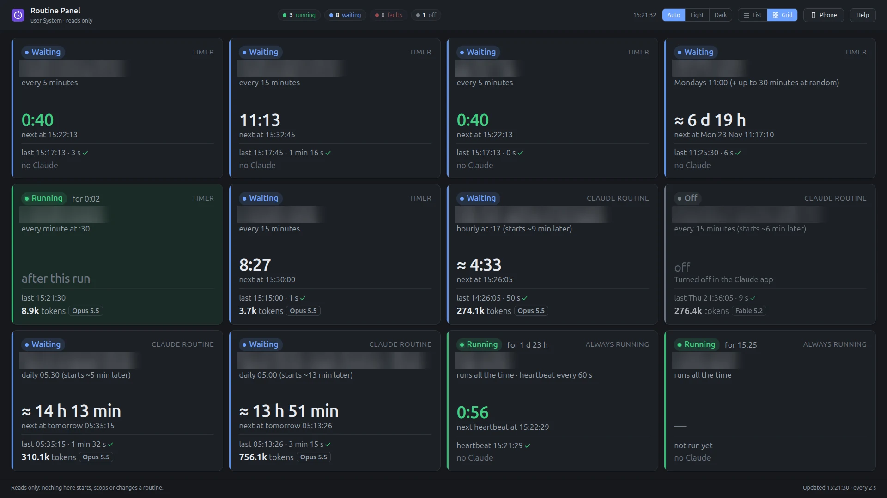
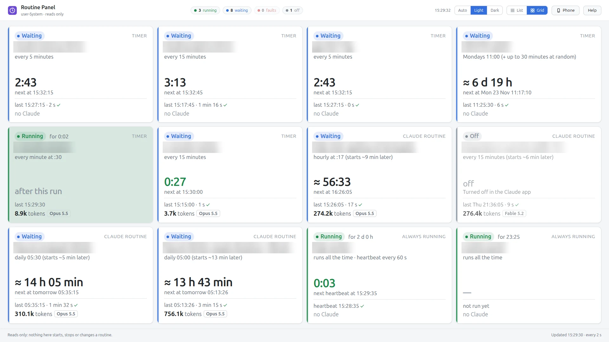
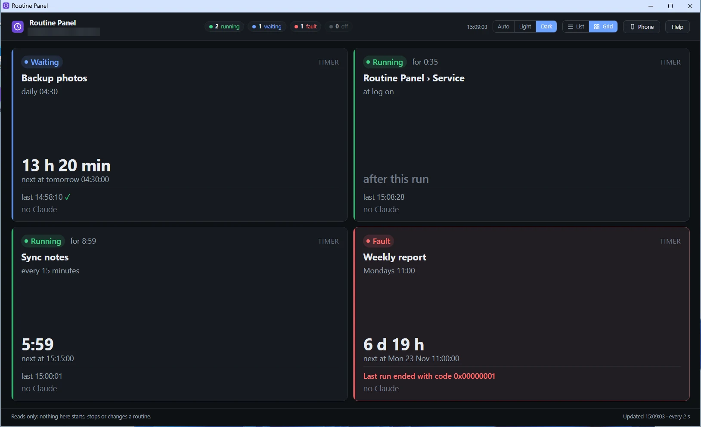
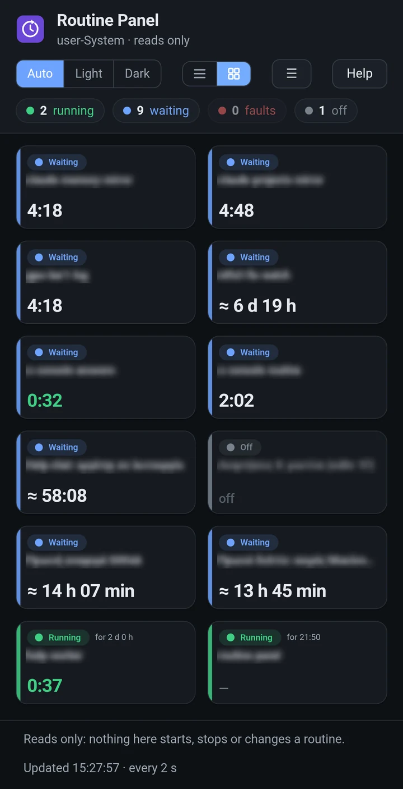

# Routine Panel

**HOME LAB · by the mechanic**

Download: [Linux](https://github.com/themechanic-dev/routine-panel/releases/latest/download/routine-panel-linux.tar.gz) · [Windows](https://github.com/themechanic-dev/routine-panel/releases/latest/download/routine-panel-setup.exe) · [Android (APK)](https://github.com/themechanic-dev/routine-panel/releases/latest/download/routine-panel-android.apk)

Every routine and automation of your computer in one window: whether it is
running now, how long until it runs next, how its last run went, and how many
tokens its last cycle used. Systemd timers on Linux, Task Scheduler on Windows,
the Claude desktop app's scheduled routines, and programs that run all the time.

It only reads. Nothing in it starts, stops or changes a routine.

A phone app shows the same panel, at home over the home network and away over
Tailscale, after you scan a code once.

Free and open source (MIT). Python standard library only: no packages to install.



## Why we built it

- **The automations multiplied.** Timers that copy files, routines in the Claude
  app that write reports every morning, a worker that must never stop. Each one
  lives in a different place, and none of them says when it has stopped working.
- **One look should answer "is everything all right?"** Running, waiting, fault
  or off, with a countdown to the next run, so a routine that did not run when it
  should have stands out in red instead of being noticed days later.
- **Tokens per cycle, not totals.** A routine that runs every hour costs its
  cycle 24 times a day. The first time the panel ran, it showed one hourly routine
  using about 270,000 tokens a cycle to run two commands. Totals hide that; the
  last cycle shows it.

## What it shows

For every routine and automation:

- **State.** Running (and for how long), Waiting, Fault (with the reason and the
  last lines of its log) or Off. A row lights up for a moment when its routine
  starts. "Needs you" marks a routine that is fine but waits for your answer.
- **Next run.** A countdown, every second, and the time. Claude routines start a
  few minutes after their time, the same few minutes each time: the panel learns
  that delay and marks the next run with ≈.
- **Last run.** When it started, how long it took and what it said at the end.
- **Tokens of the last cycle.** What was sent to Claude, what was read from the
  cache, and what Claude wrote, with the model. "no Claude" for routines that do
  not use it.
- **Schedule** in words: "every 15 minutes", "daily 05:30", "Mondays 11:00".

Two views, switched at the top right:

- **List**: one row per routine, grouped by where it comes from. Click a row for
  its details: where it comes from, the exact numbers, the last lines of its log.
- **Grid**: every routine as a tile, all of them in the window without scrolling.
  The number of columns and the size of the text follow the window and the number
  of routines, and change again when a routine is added.

Light, dark, or the system's own theme. With the `desk` command of
[Voice Console](https://github.com/themechanic-dev/claude-code-voice-console)
installed, the window also opens on the screen where it was when you closed it,
full screen if it was; without it, the desktop places it.



## Where it reads from

| What | Linux | Windows |
|---|---|---|
| Timers and scheduled tasks | your own systemd timers (`systemctl --user`) and their journal | your own Task Scheduler tasks (those whose author is you) |
| Claude routines | the Claude desktop app's scheduled tasks and their runs; tokens from Claude Code's transcripts | the same, in the Claude app's folder (Store or installer version) |
| Always running | programs you name in the settings, with an optional heartbeat file | the same |
| Tokens of your own programs | any program that writes each call to Claude in its log ("asked claude-…: N tokens in, M out", or a pattern of your own) | the same |

The system's own timers and tasks are left out unless you ask for them.

## Install

### Linux

Needs Python 3.10 or newer and systemd. Tested on Ubuntu 26.04.
The window opens in Google Chrome, Chromium or Microsoft Edge as an app window;
without any of them it opens in a tab of your default browser.

```sh
tar xzf routine-panel-linux.tar.gz
cd routine-panel-*/
./install.sh            # the window only
./install.sh --phone    # the window, and the service that phones connect to
```

Routine Panel appears in the app menu with its own icon. `./uninstall.sh`
takes it away again (`./uninstall.sh --all` also removes its settings).

### Windows

Run `routine-panel-setup.exe`. Tested on Windows 11. The window opens in Chrome,
or in Microsoft Edge, which every Windows has.

The Setup's option **"Let my phone see the panel"** adds the service that phones
connect to (it starts when you sign in) and lets the home network and Tailscale
reach it through the firewall.



### Android

Install `routine-panel-android.apk` (Android 11 or newer), then pair it with
your computer.



## Pairing a phone

1. On the computer, install the service (`./install.sh --phone`, or the
   Setup's phone option).
2. In the panel, press **Phone**, then **Pair a phone**. A code appears.
3. In the app on the phone, tap **Scan the code** and point the camera at it
   (the phone's own camera app can scan it too).

That is all. At home the phone reaches the computer over the home network; away
it uses Tailscale, if both the phone and the computer are in your Tailscale
network. It tries the home address first.

A phone only reads, like the window. Each phone has a key of its own, kept on
the computer only as a hash; **Remove** in the Phone window takes it away at
once. A code nobody scanned stops working after 10 minutes.

## Settings

All optional, in `~/.config/routine-panel/settings.json`
(on Windows `%APPDATA%\RoutinePanel\settings.json`). The panel reads them when it opens.

```json
{
  "screen": 2,
  "window_mode": "fullscreen",
  "token_logs": { "my-bot.service": "~/.local/share/my-bot/calls.log" },
  "processes": [
    { "unit": "my-worker.service", "heartbeat": "~/my-worker/heartbeat", "every_s": 60, "log": "~/my-worker/worker.log" }
  ],
  "hidden": ["timer:backup.timer"],
  "labels": { "timer:backup.timer": { "name": "Nightly backup" } }
}
```

| Setting | What it does |
|---|---|
| `screen` | the monitor the window opens on the first time (with Voice Console's `desk`) |
| `window_mode` | `normal`, `maximized` or `fullscreen`, the first time; after that the window opens as it was (with `desk`) |
| `window_size` | `[width, height]` of a new window |
| `token_logs` | `{"unit.service": "log file"}` for a program that calls Claude itself, or `{"path": …, "pattern": …}` with a regular expression of your own (named groups `ts`, `input`, `output`) |
| `processes` | programs that run all the time: `unit` (or `match`, text in the command line), `name`, `about`, `heartbeat`, `every_s`, `log` |
| `logs` | `{"unit.service": "log file"}`: a log whose last lines a row shows |
| `hidden` | ids of rows to leave out (each row's details show its id) |
| `labels` | another name or line for a row |
| `show_system_timers` | also show the system's own timers and tasks |
| `lan` | phones may also connect over the home network, not only Tailscale (default `true`) |
| `port` | the service's port (default 47613) |
| `chrome` | where the browser's program is, when it is not where it installs itself |
| `claude_sessions`, `claude_projects` | the Claude app's sessions folder and Claude Code's transcripts folder, when they are not in the usual place |

## Command line

```
routine-panel                  open the window (or bring it to the front)
routine-panel --theme dark     start in light or dark, whatever the system's theme
routine-panel --view grid      start in the list or the grid
routine-panel --screen 2       open on that monitor (with Voice Console's desk)
routine-panel --print          print one picture of the routines as JSON, and exit
routine-panel --serve          only the local server, for a browser of your own
```

## It only reads

There is no button that changes anything, and the panel's server has no request
that writes, except pairing and removing phones. To change a routine, use the
place it belongs to: the Claude app, `systemctl --user`, or Task Scheduler.

The panel's server answers only this computer, and paired phones over Tailscale
and the home network, each with its key.

## From the source

```sh
python3 -m unittest discover -s tests -t .     # the tests
python3 bin/routine-panel                       # run it without installing
packaging/make-linux-tarball.sh                 # the Linux download
```

The Windows Setup is built on Windows with `packaging/windows/build.ps1`
(PyInstaller and Inno Setup). The Android app is in `android/`
(`./gradlew assembleRelease`).

```
routine_panel/   the app: readers (systemd, Task Scheduler, Claude routines, logs), the local server, the window
routine_panel/web/  the page that both the window and the phone show
android/         the phone app (Kotlin, one WebView, the code scanner)
packaging/       launcher, icons, service, Windows Setup
tests/           the tests
```

## License

MIT. See [LICENSE](LICENSE).

---

HOME LAB · by the mechanic
